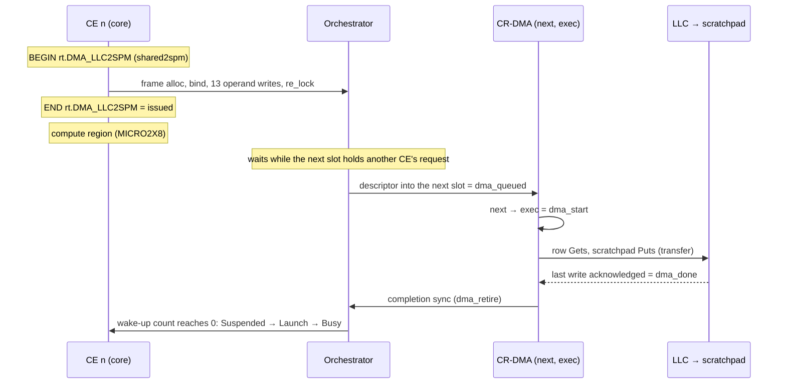
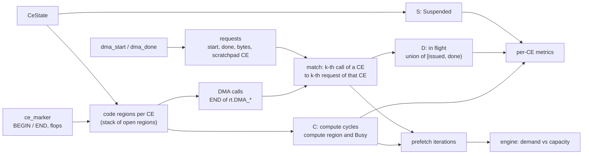

# Compute / DMA overlap per CE: how it is measured

| | |
|---|---|
| Plugin | [`overlap_metrics.py`](../overlap_metrics.py) (load after `dma_metrics.py` and `ce_phases.py`; `redefine_report.py` does) |
| Where it shows | report chapter *5 · Data movement and compute overlap (CR-DMA)*, Perfetto process **CE ↔ DMA overlap**, `<stem>.overlap.json` |
| Cross-check | [`overlap_xcheck.py`](../overlap_xcheck.py) recomputes everything from the Perfetto JSON alone (§6) |
| Example numbers | dmaMatmul, 1 CR × 4 CEs (`1CR/dmaMatmul_working`, trace `mm_phase`) |

## 1. The question

A double-buffered kernel asks the CR-DMA for chunk *k+1*, computes on chunk *k*, then sleeps until the
request completes. In dmaMatmul (`mm-baremetal-examples/1CR/dmaMatmul_working/dmaMatmul.c` in the SDK, the
worker's strip loop):

```c
fetchChunk(wakeUp, W, k + K_CHUNK, col, wNext);  // PCM_LLC2SPM: shared2spm -> one CR-DMA request, 1 KB
multiplyChunk(aPiece, k, wCur, zCur, 1);         // PCM_MICRO2X8: compute on the other buffer
re_suspend();                                    // CE_SUSPEND: sleep until the request is done
swap = wCur, wCur = wNext, wNext = swap;
```

For every CE the plugin answers three questions:

1. **Is it overlapped?** Is a transfer running while the CE computes?
2. **Is the overlap enough?** Does the data arrive before the compute ends? If not, is the time spent waiting
   for the shared engine or in the transfer itself?
3. **Is it safe?** Does the CE touch a buffer while a DMA into or out of it is still in flight?

## 2. Inputs

The kernel needs nothing beyond PC_MARK around its compute. The issue time comes from markers the runtime adds
itself (`mm-baremetal-examples/CwithHyperOps/include/redefine_pc_markers.h` in the SDK):

| Runtime call | Marker |
|---|---|
| `shared2spm` | `RE_PCM_DMA_LLC2SPM` (0x400) |
| `spm2shared` | `RE_PCM_DMA_SPM2LLC` (0x410) |
| `local2local` | `RE_PCM_DMA_LLC2LLC` (0x420) |
| scatter / gather | 0x430 / 0x440 |

| What | Probe | RTL instance · Chisel source | Group (default) |
|---|---|---|---|
| CE state: Busy / Suspended / Launch / Idle | `CeState` | `baseCr.orch.ceIfc_N` · CEIfc.scala:71 | `hyperop` (on) |
| Code regions with flops retired (kernel PC_MARK + runtime markers) | `ce_marker` | `baseCr.core[_N].rockettile.core` · CeRocketCore.scala:69 | `ce_phase` (on) |
| Request written into the CR-DMA's *next* slot | `dma_queued` | `baseCr.uncore.crDma.regNode` · nodeImp.scala:572 | `CR_DMA` (on) |
| Request starts (next → exec): type, src, dst, rows × rowBytes | `dma_start` | `baseCr.uncore.crDma.regNode` · nodeImp.scala:574 | `CR_DMA` (on) |
| Last write of the request acknowledged | `dma_done` | `baseCr.uncore.crDma.mbusMaster` · nodeImp.scala:1247 | `CR_DMA` (on) |
| CE scratchpad loads and stores (safety check only) | `spm_access` | `baseCr.core[_N].rockettile.dcache` · NBDCache.scala:949 | `l1d_spm` (**off**: `+rtltrace_l1d_spm_on`) |
| CE read during a DMA write (hardware hazard) | `spm_s3_overlap` | `baseCr.core[_N].rockettile.dcache` · NBDCache.scala:962 | `l1d_spm_check` (on) |

## 3. The life of one request



**Why "issued" is the END of the runtime call, not `dma_queued`.** The engine holds one request in *exec* and
one in *next*. Requests from the other CEs wait in the Orchestrator, where no CR-DMA probe sees them. In
dmaMatmul, issued → queued is 1,474 cycles (p50) and queued → start is 566 cycles. Using `dma_queued` would hide
about three quarters of the wait.

## 4. How it is computed

Every quantity is a set of cycles inside the kernel window *W*. *W* runs from the first CE leaving Idle to the
last CE returning to Idle (the same window as γe). |X| is the number of cycles in X.



### 4.1 Compute cycles C

1. Build each CE's code-region timeline from the `ce_marker` BEGIN/END events, using a stack of open regions,
   and `CeState`. The stack clears when the CE goes Idle or starts a new hyperOp.
2. **Compute regions** are the regions that retire at least 0.1 flops per Busy cycle over all CEs. The flops
   come from the counters carried by the markers. Alternatively, name them with
   `--plugin-arg compute=MICRO2X8,...`. In dmaMatmul only MICRO2X8 qualifies (1.005 flops/cycle); every other
   region retires 0.
3. **C** = the cycles where the innermost open region is a compute region and the CE is Busy.

### 4.2 Issue time and owning CE of each request

1. **Requests:** each `dma_start` is paired with the next `dma_done`. This gives start, done, type and
   bytes = rows × rowBytes.
2. **Owning CE:** the scratchpad side of the request. That is the dst of an LLC2SPM or the src of an SPM2LLC; CE
   n's scratchpad is 0x3000_0000 + n × 0x2000 (`spm_base`, `spm_stride`).
3. **Calls:** each CE's runtime DMA-call regions (`rt.DMA_LLC2SPM` … from BEGIN to END). A call contains its own
   frame-alloc and frame-bind regions. **Issue time = END of the call**, after `re_lock` has handed the request to
   the Orchestrator.
4. **Matching:**
   - The k-th LLC2SPM call of CE n is matched to the k-th LLC2SPM request whose scratchpad is CE n. SPM2LLC works
     the same way.
   - LLC2LLC, scatter and gather have no scratchpad side. All CEs' calls in time order are matched to the requests
     in start order, and the calling CE becomes the owner.
5. **Validation:**
   - Counts must be equal, and every call must end no later than 1 cycle after its request starts.
   - If either check fails, the issue time is `dma_queued` instead. That is later than the real issue, so the wait
     for the engine is under-counted, and the report shows a warning.
   - dmaMatmul: all 650 requests matched (520 LLC2SPM, 128 SPM2LLC, 2 LLC2LLC).

### 4.3 Cycle sets

- **D** (DMA in flight) = the union over the CE's requests of [issued, done). Overlapping requests count once.
- **S** = the cycles where `CeState` is Suspended.

### 4.4 Per-CE metrics: table *Compute / DMA overlap per CE*

| Column | JSON key (`ces[]`) | Formula | Read it as |
|---|---|---|---|
| compute | `compute` | \|C\| | |
| DMA in flight | `inflight` | \|D\| | |
| overlapped | `overlap` | \|C ∩ D\| | |
| compute with DMA underneath % | `covered` | \|C ∩ D\| / \|C\| | Is the loop double-buffered at all? Near 100 % means yes. |
| DMA hidden % | `hidden` | \|C ∩ D\| / \|D\| | The share of DMA time the CE spent computing. Higher is better. |
| exposed DMA | `exposed` | \|D\| − \|C ∩ D\| | DMA time with no compute running. |
| exposed while suspended | `exposed_suspended` | \|D ∩ S\| | The part of that time the CE slept, waiting for the data. |
| suspended, no DMA in flight | `suspended_no_dma` | \|S \ D\| | Waiting for something else (sync, other CEs). Also includes the wake-up after each `dma_done`. |

### 4.5 Prefetch iterations: table *Prefetch iterations (double buffering)*

**What counts as an iteration:**
- An iteration is one contiguous compute interval [c0, c1) of C.
- Its requests are the CE's requests issued after the previous compute interval ended and at most
  `prefetch_gap` (512) cycles before c0.
- Blocking loads (`copyIn`: issue, then sleep until the data arrives) start their compute more than 512 cycles
  after issue, so they are not prefetches.

**Fields.** In each iteration, *arrived* is the latest `done` of its requests and *last* is the request that
finished last.

| Field | JSON key (`iterations[]`) | Formula |
|---|---|---|
| compute | `compute` | c1 − c0 |
| issue → data arrived | `latency` | arrived − earliest issued |
| wait for engine | `engine_wait` | last.start − last.issued |
| transfer | `service` | last.done − last.start |
| other CEs' requests ahead | `ahead` | requests of other CEs that started between last.issued and last.start |
| ready before compute ended | `ready` | arrived ≤ c1 |
| exposed wait | `exposed_wait` | max(0, arrived − c1) |
| wake-up | `wake` | first Busy start at or after *arrived*, minus *arrived* (only when arrived > c1) |

The report shows the share of iterations that were ready and the median (p50) of each other field.

### 4.6 Can the shared CR-DMA keep up? Table *Can the shared CR-DMA keep up?*

All CEs of a CR share one engine:

- **needed** = the sum over CEs of (bytes of the CE's prefetch requests ÷ compute cycles of its iterations)
- **delivered** = bytes ÷ (done − start) over all prefetch requests, i.e. the engine's bytes/cycle while it is
  transferring
- **demand ÷ capacity** above 1 means the transfers cannot be hidden, however deep the prefetch.

### 4.7 Is it safe? Table *Is the overlap safe?*

- **Load from a buffer still being filled:** a CE load (`spm_access`, not a write) inside [dst, dst + bytes) of an
  LLC2SPM request of that CE, between issued and done.
- **Store into a buffer still being sent:** a CE store inside [src, src + bytes) of an SPM2LLC request of that
  CE, between issued and done.
- **`spm_s3_overlap` events** are split two ways:
  - *same buffer*: the address is inside an LLC2SPM request of that CE that is transferring at the time. This is a
    kernel race.
  - *another buffer*: the hardware hazard described in dmaMatmul.c (lines 34–39).

## 5. dmaMatmul

| CE | compute | DMA in flight | overlapped | compute with DMA underneath | DMA hidden | exposed | exposed while suspended | suspended, no DMA |
|---|---:|---:|---:|---:|---:|---:|---:|---:|
| CE0 | 260,733 | 451,789 | 256,059 | 98.2 % | 56.7 % | 195,730 | 187,459 | 4,504 |
| CE1 | 261,239 | 361,970 | 256,276 | 98.1 % | 70.8 % | 105,694 | 97,813 | 4,450 |
| CE2 | 260,649 | 366,022 | 255,919 | 98.2 % | 69.9 % | 110,103 | 102,715 | 3,908 |
| CE3 | 260,437 | 367,089 | 255,775 | 98.2 % | 69.7 % | 111,314 | 103,308 | 4,414 |

| CE | iterations | ready before compute ended | compute p50 | issue → arrived p50 | wait for engine p50 | transfer p50 | ahead p50 | exposed wait p50 | wake-up p50 |
|---|---:|---:|---:|---:|---:|---:|---:|---:|---:|
| CE0 | 126 | 0.8 % | 2,047 | 2,798 | 1,949 | 712 | 2 | 664 | 21 |
| CE1 | 126 | 2.4 % | 2,047 | 2,665 | 1,937 | 712 | 2 | 623 | 21 |
| CE2 | 126 | 0.8 % | 2,047 | 2,750 | 2,039 | 712 | 2 | 694 | 21 |
| CE3 | 126 | 0.8 % | 2,047 | 2,659 | 1,945 | 712 | 2 | 613 | 21 |

The engine moves 1.42 B/cycle while transferring, and the four CEs need 2.07 B/cycle: **demand ÷ capacity =
1.46**. Across the 291,389 scratchpad accesses, no load hit a buffer still being filled and no store hit a buffer
still being sent. All 459 `spm_s3_overlap` events hit *another* buffer.

**What the numbers say:**

- **Double buffering is in place.** 98 % of compute has a transfer underneath. The rest is the last chunk of each
  row block, which has nothing left to fetch.
- **It is not enough.** Data arrives in time in only 1 % of iterations: a few at the start, before all four CEs
  are prefetching, and a few at the end, after the others have finished. Each request waits behind the other
  three CEs' requests, so issue → arrived (2,660–2,800 cycles) is longer than the compute (2,047). The CE sleeps
  for the difference.
- **The engine is the limit, not the prefetch distance.** Demand ÷ capacity is 1.46. Prefetching deeper would
  not help. What helps is more compute per transferred byte (more reuse of each W chunk) or more engines (each CR
  has its own).
- **CE0's DMA hidden is lower (57 %)** because of the two LLC2LLC staging copies during setup. A (16 KB) and W
  (64 KB) are in flight from cycle 14,789 to 101,963 while CE0 has nothing to compute.
- **"Suspended, no DMA in flight"** (~4,400 cycles per CE) is the wake-up after each of the ~125 prefetch
  waits of a CE (p50 21 cycles, mean ~35). All of the CEs' suspended time is DMA wait.

### One iteration, cycle by cycle

This is CE1's 11th prefetch iteration (`overlap_xcheck.py --example CE1:10` prints it):

| cycle | CE1 | CR-DMA engine (one request at a time) |
|---:|---|---|
| 140,743 | Busy: woken for this iteration | CE0's request is transferring (140,640 → 141,351) |
| 140,762 | BEGIN `rt.DMA_LLC2SPM`, `shared2spm` for chunk *k+1* | CE2's and CE3's requests are waiting in the Orchestrator |
| 140,942 | END `rt.DMA_LLC2SPM` → **issued**. The call took 180 cycles: frame alloc 3, frame bind 9, operand writes and `re_lock` 168 | |
| 140,944 | BEGIN MICRO2X8 | |
| 141,357 | | CE2's transfer (711 cycles) |
| 142,074 | | CE3's transfer (714 cycles) |
| 142,227 | | CE1's request enters the *next* slot (`dma_queued`) |
| 142,794 | | CE1's transfer starts (`dma_start`) |
| 142,991 | END MICRO2X8 (2,047 cycles), `re_suspend` | |
| 142,996 | Suspended | |
| 143,508 | | `dma_done`: **data arrived** |
| 143,529 | Busy (wake-up 21) | |

The numbers for this iteration:

| Metric | Value |
|---|---|
| issue → data arrived | 2,566 = wait for engine 1,852 + transfer 714 |
| wait for engine | 1,852 = rest of CE0's transfer 409 + CE2's 711 + CE3's 714 + three 6-cycle gaps |
| other CEs' requests ahead | 2 (CE2, CE3); CE0's was already transferring |
| exposed wait | 517 = 143,508 − 142,991, so the data was not ready |
| overlap | 2,047: the whole compute had the request in flight underneath |

In Perfetto, 1 µs on the time axis is 1 cycle. Slices start at cycle + 0.5.

## 6. Cross-check against the Perfetto JSON

```sh
python3 overlap_xcheck.py <report dir>/mm_phase   # needs redefine_report.py --perfetto-full for the raw source
```

The script imports nothing from rtltrace. It recomputes everything from two sources:

| Source | Reads | Independent of the plugin in |
|---|---|---|
| **tracks** (`.perfetto.json`, kernel view) | *Kernel overview › kernel window*, *CEn ↔ Orchestrator interface › CE state*, *CE code regions (PC_MARK) › CEn* and its *flops/cycle* counter, *CR-DMA requests* | compute regions from the integral of the counter; DMA calls from each slice's `nesting` path; matching; all arithmetic |
| **raw** (`.perfetto_full.json`) | raw `ce_marker`, `CeState`, `dma_queued` / `dma_start` / `dma_done` events | its own marker stack and flops attribution; `dma_start`↔`dma_done` paired in FIFO order instead of by search; everything above |

The arithmetic also differs from the plugin's:
- It uses one bit per cycle (Python integers) instead of interval lists.
- A prefetch request is one issued after the previous compute with *no suspend before the compute starts*,
  instead of the 512-cycle gap.

**Result for dmaMatmul: everything agrees.**
- The plugin, tracks and raw sources agree exactly on all 20 per-CE metrics for all 4 CEs, and on the engine's
  capacity, demand and ratio.
- Tracks and raw agree on the inputs: the window (13,712 – 565,878), the CE states, the compute cycles and the
  650 requests with their issue times.
- The *CE ↔ DMA overlap* lanes in Perfetto carry the same 650 issue times.
- The two prefetch rules give the same 504 iterations, identical field by field to the plugin's.

The cross-check validates how the metrics are derived and computed. It does not validate the probes: both sources
read the same RTL events.

The plugin tests run the same cross-check on a synthetic two-iteration trace (`tests/test_overlap.py`), so a change
to the plugin or to the Perfetto export that breaks the agreement fails the tests.

### Checking it by eye in ui.perfetto.dev

Open `<stem>.perfetto.json` and pin these tracks for one CE:

1. *CE code regions (PC_MARK) › CE1*: MICRO2X8 slices, each preceded by *runtime · DMA LLC→SPM call*.
2. *CE ↔ DMA overlap › CE1 DMA*: each request as *LLC2SPM waiting for engine* (from its issue time) followed by
   *LLC2SPM transfer 1024 B*.
3. *CE1 ↔ Orchestrator interface › CE state*.
4. *CR-DMA requests › requests*: the engine, one request at a time, labelled with the CE.

Overlap is the DMA lane running under a MICRO2X8 slice. Exposed time is the part of the transfer to the right of
the slice's end, where CE state shows Suspended. Clicking a slice shows its start and duration; dragging across a
range lists the slices in it with their total durations.

## 7. Assumptions and limits

- **Runtime calls only.** The issue time needs the runtime DMA calls (`shared2spm`, `spm2shared`, `local2local`,
  scatter/gather), which carry the markers. A kernel that programs the CR-DMA directly gets `dma_queued` as its
  issue time; the report warns about this, and the wait for the engine is under-counted.
- **In-order service.** Matching assumes the engine serves one CE's requests of one type in the order the CE issued
  them. Every run checks this: counts must be equal and each call must end no later than 1 cycle after its request starts (§4.2).
- **Compute must be marked.** Compute must sit inside PC_MARK regions. Unmarked compute shows as "busy, outside
  any marker" and is not counted. For integer-only kernels, name the regions with `compute=<regions>`.
- **`prefetch_gap` bounds the prefetch distance.** It is the furthest ahead of its compute (512 cycles) that a
  request can be issued and still count as that iteration's prefetch. A kernel that issues earlier (for example
  two chunks ahead) needs `--plugin-arg prefetch_gap=<cycles>`. The per-CE overlap table does not depend on it.
- **"Arrived" means `dma_done`, the last write acknowledged.** The CE can use the data only after the completion
  sync and the wake-up, which are reported separately as *wake-up*.
- **Scratchpad map.** The owning CE comes from the scratchpad address, using `spm_base` 0x3000_0000 and
  `spm_stride` 0x2000. Other configurations need these plugin args.
- **Single CR only for now.** With several CRs, the requests of the different CRs' engines are not yet kept apart.
